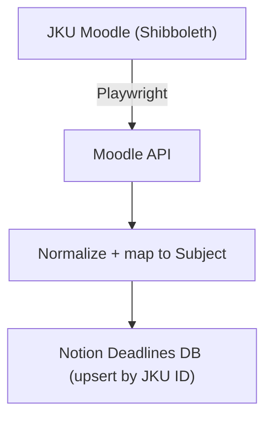

# jku-notion-sync — README

Daily sync that scrapes assignments from **JKU Moodle** and upserts them into a **Notion** Deadlines database. Runs on a GitHub Actions cron so deadlines just show up in Notion without me ever opening Moodle.

Stack: **Bun** + **TypeScript** + **Playwright**.

Repo: [github.com/paul-b-at/jku-notion-sync](http://github.com/paul-b-at/jku-notion-sync)

---

## What it does

- Logs into JKU Moodle through **Shibboleth** with Playwright (headless).
- Hits the authed Moodle API to pull assignments across all enrolled courses.
- Maps each course to a Notion **Subject** via normalized course numbers (dots/spaces stripped).
- Upserts rows into the Notion Deadlines DB, deduped by **JKU ID**.
- Logs a short summary (created / updated / skipped) per run.

## How it works



- **Auth:** Playwright drives the Shibboleth login flow once per run, grabs the session, then talks to Moodle's API directly.
- **Dedup key:** every assignment has a stable `JKU ID`. If a row with that ID already exists → update. Otherwise → create.
- **Subject mapping:** course numbers like `326.0AB` and `326 0AB` both normalize to `3260AB`, so the lookup is robust against Moodle formatting drift.

## Setup

### 1. Requirements

- [Bun](https://bun.sh) ≥ 1.x
- A Notion integration with access to the Deadlines DB
- JKU credentials (k-number + password)

### 2. Install

```bash
bun install
bunx playwright install chromium
```

### 3. Env vars

Create a `.env` (and mirror these as GitHub Actions secrets):

```bash
# JKU
JKU_USERNAME=k1234567
JKU_PASSWORD=your-password

# Notion
NOTION_TOKEN=secret_xxx
NOTION_DEADLINES_DB_ID=xxxxxxxxxxxxxxxxxxxxxxxxxxxxxxxx
```

### 4. Run locally

```bash
bun run sync
```

## Notion DB schema

The Deadlines DB expects (at least) these properties:

| Property | Type | Notes |
| --- | --- | --- |
| Name | Title | Assignment title from Moodle |
| JKU ID | Text | **Dedup key** — unique per assignment |
| Subject | Relation | Linked to the Subjects DB via course no. |
| Due date | Date | Deadline from Moodle |
| Status | Status | e.g. `Open` / `Submitted` / `Overdue` |
| URL | URL | Direct link back to the Moodle activity |

Adjust property names in the code if yours differ.

## GitHub Actions

Runs daily on a cron schedule (and on manual `workflow_dispatch`):

```yaml
# .github/workflows/sync.yml
on:
  schedule:
    - cron: "0 5 * * *" # 05:00 UTC daily
  workflow_dispatch:
```

Required repo secrets:

- `JKU_USERNAME`
- `JKU_PASSWORD`
- `NOTION_TOKEN`
- `NOTION_DEADLINES_DB_ID`

## Project structure

```
.
├── src/
│   ├── moodle/        # Playwright login + API client
│   ├── notion/        # Notion client + upsert logic
│   ├── mapping/       # Course number normalization + subject lookup
│   └── index.ts       # Entry point
├── .github/workflows/sync.yml
├── package.json
└── README.md
```

## Troubleshooting

- **Login fails:** Shibboleth UI sometimes changes. Re-run with `HEADLESS=false` to watch the flow and update selectors.
- **Subject not linked:** check that the course number normalizes to something that exists in the Subjects DB. Strip everything that isn't `[A-Z0-9]`.
- **Dupes appearing:** make sure the `JKU ID` property is set and consistent — the upsert keys off it exclusively.

## License

MIT (or whatever — personal project).