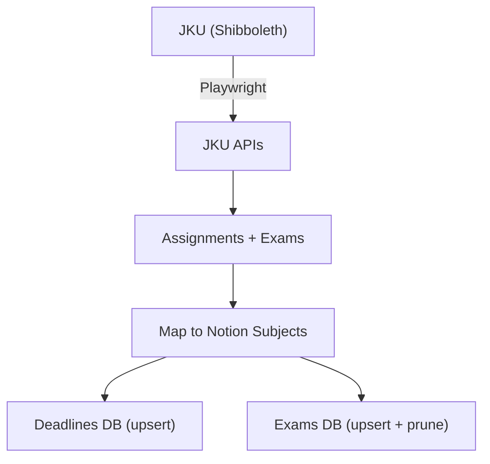

# jku-notion-sync

Daily sync that pulls **JKU Moodle assignment deadlines** and **registered exams** into **Notion** databases. Runs on a GitHub Actions cron so deadlines and exam dates show up without opening Moodle.

Stack: **Bun** + **TypeScript** + **Playwright**.

Repo: [github.com/paul-b-at/jku-notion-sync](https://github.com/paul-b-at/jku-notion-sync)

---

## What it does

### Assignment deadlines

- Authenticates against JKU via **Shibboleth** (Playwright, headless).
- Fetches upcoming Moodle assignment due dates from the JKU calendar API.
- Maps each course to a Notion **Subject** by normalized course number.
- Upserts rows into the Deadlines database, deduped by **JKU ID**.

### Exams

- Fetches current exam registrations from the JKU exams API.
- Keeps only upcoming exams (past dates are skipped).
- Upserts rows into the Exams database, deduped by **JKU ID**.
- Links exams to Subjects by course number when available, otherwise by normalized course name.
- **Prunes cancelled exams:** future-dated rows with `Source = JKU Sync` that no longer appear in the JKU feed are archived in Notion.

Each run logs a summary of created, updated, unmatched, and pruned records.

## How it works



- **Auth:** Playwright opens a persistent browser profile (`.session/` locally). It probes a JKU API endpoint; if the session is missing or expired, it runs the Shibboleth login flow. CI performs a fresh login on every run.
- **Dedup key:** both assignments and exams use a stable **JKU ID**. Existing row → update; otherwise → create.
- **Subject mapping:** course numbers like `326.0AB` and `326 0AB` normalize to `3260AB`. Exams fall back to matching the Subject **Name** when no course number is present.

## Setup

### Requirements

- [Bun](https://bun.sh) ≥ 1.x
- A Notion integration with access to the Deadlines, Exams, and Subjects databases
- JKU credentials (k-number + password)

### Install

```bash
bun install
bunx playwright install chromium
```

### Environment variables

Copy `.env.example` to `.env` (Bun loads it automatically). Mirror the same values as GitHub Actions secrets:

```bash
JKU_USER=k1234567
JKU_PASS=your-password
NOTION_TOKEN=secret_xxx
NOTION_DEADLINES_DB=xxxxxxxxxxxxxxxxxxxxxxxxxxxxxxxx
NOTION_SUBJECTS_DB=xxxxxxxxxxxxxxxxxxxxxxxxxxxxxxxx
NOTION_EXAMS_DB=xxxxxxxxxxxxxxxxxxxxxxxxxxxxxxxx
```

Database IDs are the 32-character hex strings from each Notion database URL.

### Run locally

```bash
bun run src/index.ts
```

Options:

- `--dry-run` — fetch and log results without writing to Notion
- `--debug` — write raw exam API response to `debug-exams.json`

## Notion database schema

Property names must match what the code writes (adjust the code if yours differ).

### Subjects

| Property | Type | Notes |
| --- | --- | --- |
| Name | Title | Subject display name |
| Course Number | Text | VL course number |
| UE Course Number | Text | Optional UE course number |

### Deadlines

| Property | Type | Notes |
| --- | --- | --- |
| Name | Title | Assignment title |
| JKU ID | Text | Dedup key |
| Due Date | Date | Deadline (UTC) |
| Moodle Link | URL | Link to Moodle activity |
| Subject | Relation | Linked Subjects row |
| Last Synced | Date | Set on every sync |
| Source | Select | `JKU Sync` |

### Exams

| Property | Type | Notes |
| --- | --- | --- |
| Name | Title | Course / exam name |
| JKU ID | Text | Dedup key |
| Date | Date | Exam date (UTC) |
| JKU Link | URL | Optional detail link |
| Subject | Relation | Linked Subjects row |
| Last Synced | Date | Set on every sync |
| Source | Select | `JKU Sync` — only these rows are pruned |

## GitHub Actions

Runs daily at **06:00 UTC** (08:00 Vienna in summer, 07:00 in winter) and on manual `workflow_dispatch`:

```yaml
on:
  schedule:
    - cron: '0 6 * * *'
  workflow_dispatch:
```

Required repository secrets:

| Secret | Purpose |
| --- | --- |
| `JKU_USER` | JKU k-number |
| `JKU_PASS` | JKU password |
| `NOTION_TOKEN` | Notion integration token |
| `NOTION_DEADLINES_DB` | Deadlines database ID |
| `NOTION_SUBJECTS_DB` | Subjects database ID |
| `NOTION_EXAMS_DB` | Exams database ID |

## Project structure

Flat `src/` layout — no nested packages:

| File | Role |
| --- | --- |
| `src/index.ts` | Entry point: loads subjects, syncs assignments and exams, prints summary |
| `src/auth.ts` | Playwright Shibboleth login and authenticated browser context |
| `src/jku.ts` | Fetches Moodle assignment due dates from the JKU calendar API |
| `src/exams.ts` | Fetches and parses upcoming exam registrations from the JKU exams API |
| `src/notion.ts` | Notion client: subject map, course-number normalization, assignment upserts |
| `src/notionExams.ts` | Exam upserts and pruning of cancelled future exams |

```
.
├── src/
│   ├── auth.ts
│   ├── jku.ts
│   ├── exams.ts
│   ├── notion.ts
│   ├── notionExams.ts
│   └── index.ts
├── .github/workflows/sync.yml
├── package.json
└── README.md
```

## Troubleshooting

- **Login fails:** Shibboleth UI sometimes changes. Run locally with a visible browser (`headless: false` in `auth.ts`) to inspect the flow and update selectors.
- **Subject not linked:** confirm the course number normalizes to a value in the Subjects database, or that the exam course name matches a Subject **Name** exactly (case-insensitive).
- **Duplicate rows:** upserts key off **JKU ID** only — ensure that property is populated and stable.
- **Exams missing:** run with `--debug` and inspect `debug-exams.json` if the JKU API response shape changed.

## License

MIT
